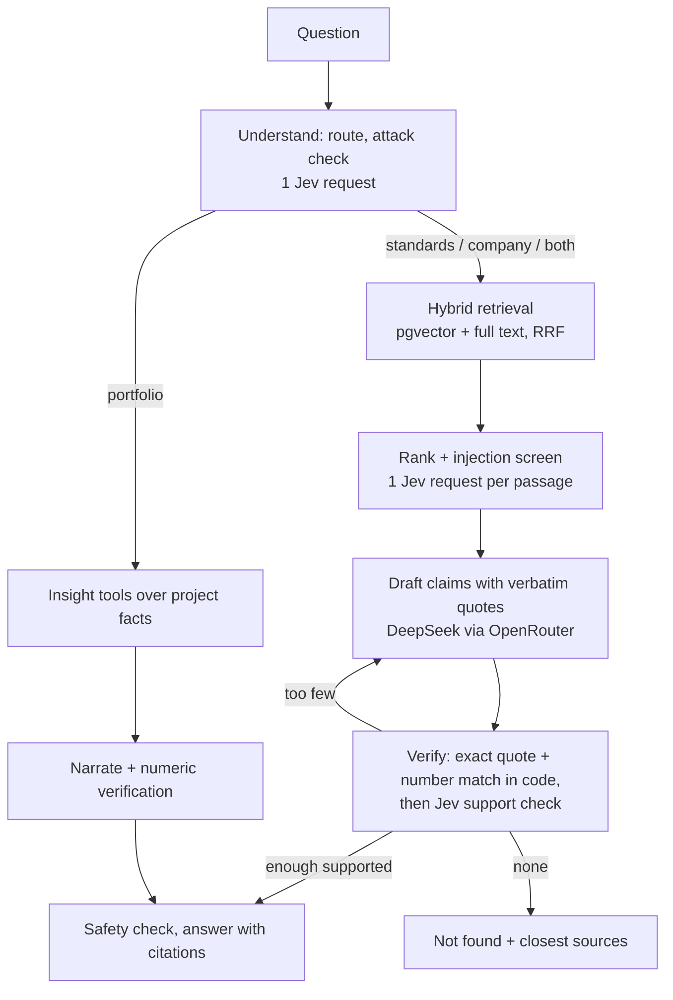

# Site Data Desk

A cited-answer assistant for environmental consultancies. Ask what a contaminated-land standard says, or what happened on a project, and every statement in the answer is checked against a quoted source before you see it. If the sources don't support an answer, you get **not found**, not a guess.

- **Standards:** NEPM Assessment of Site Contamination Schedules B1, B2, B3, B4, B5a and B6, from the Federal Register of Legislation (CC BY 4.0), with page-level citations.
- **Company knowledge:** a small *fictional* consultancy (Kestrel Environmental Group): four projects, 60 emails, 40 Slack messages, 8 reports, with planted traps (corrections, contradictions, a prompt-injection email, a near-duplicate report, a reversed decision).
- **Leadership view:** portfolio cards and a weekly digest where every number is verified against the project data.
- **Everything is traced, checkpointed and evaluated.** Open "How was this answered?" under any answer.

> Demonstration only. The company and its data are fictional. Not professional advice. Not affiliated with any company.

## How it works



| Task | Who does it | Why |
|---|---|---|
| Parse, chunk, embed, quote matching, number matching, quotas, thresholds, SQL | Code | Deterministic |
| Routing, relevance, injection screening, claim support, output safety, feedback triage, eval judging | **TypeSafe Jev** (Choice / Noul) | Narrow, calibrated, parallel judgments |
| Writing the claims | DeepSeek via OpenRouter (tool calling) | Prose |

The **Obsidian vault** (`vault/`) is the source of truth for all content. `make sync` copies it into Supabase (documents, chunks, embeddings, project facts) and builds the graph. Open `vault/` in Obsidian to browse the same graph the app shows.

## Run it

You need: Node 20+ (22 recommended), Python 3.12+, a Supabase project, an OpenRouter key, a TypeSafe key, and optionally Vercel.

```bash
make setup                      # python venv + web deps
cp .env.example .env            # then fill in the keys (see below)
scripts/setup-supabase.sh       # migrations + embedding Edge Function (needs `supabase login` and `supabase link`)
make seed standards sync        # fictional vault, real standards, index everything (about 1,150 chunks)
make dev                        # http://localhost:3000
```

`.env` needs: `OPENROUTER_API_KEY`, `TYPESAFE_API_KEY`, `SUPABASE_URL`, `SUPABASE_ANON_KEY`, `SUPABASE_SERVICE_ROLE_KEY` and `SUPABASE_DB_URL` (use the **session pooler**, port 5432). The salt, eval key and embed secret are generated for you.

Check the OpenRouter model id before the first run: `curl -s https://openrouter.ai/api/v1/models | grep -i deepseek`, then set `OPENROUTER_MODEL`.

### Deploy
```bash
cd web && vercel link && cd ..   # create the project once
scripts/vercel-env.sh            # copies the needed variables from .env
cd web && vercel --prod
```
Then set the repository variable `EVAL_BASE_URL` (your deployed URL) and secrets `EVAL_KEY`, `TYPESAFE_API_KEY`, `SUPABASE_DB_URL` so the nightly workflow can keep the free Supabase project awake, prune old data and run the full eval.

## Evaluation

```bash
make check          # offline: deterministic seed, golden-set validity, python tests
make test           # web unit tests and the end-to-end graph test (mocked services)
make eval           # full suite against a running app; exits non-zero if the gate fails
make eval-baseline  # accept the current run as the new baseline (a deliberate human step)
```

75 golden cases: 20 standards questions with gold pages, 15 company questions, 2 questions needing both, 8 unanswerable, 8 portfolio, 12 routing, 10 safety, plus 30 human-labelled pairs that measure how well the Jev support judge agrees with a person. Floors and the regression tolerance live in `config/thresholds.json`. `evals/check_golden.py` verifies every gold phrase really appears in the cited document and page.

## Self-improvement (gated)

1. Visitors rate answers; negative feedback is stored with the run.
2. `make triage`: Jev classifies each item (cause, actionable, spam) and finds the failing step in the trace.
3. `make improve`: drafts at most three proposals (glossary synonyms, a few retrieval thresholds, a small edit to the draft prompt) as notes in `vault/proposals/`. Guardrail settings and the eval baseline are locked.
4. `python improve/propose.py --apply <id>` creates a branch with the change; a human opens the PR and CI runs the eval gate. Nothing changes production behaviour without a merge.

## Free-tier notes

| Service | Limit relied on | If exceeded |
|---|---|---|
| Vercel Hobby | personal, non-commercial use; function/CPU quotas | account can be paused |
| Supabase Free | 500 MB database, 500k Edge Function calls/month, **pauses after about 7 days idle** | the nightly workflow pings `/api/health`; restore from the dashboard if paused |
| OpenRouter | pay-as-you-go (pennies per hundred questions) | requests fail; the per-IP and global caps limit exposure |
| Jev | per your TypeSafe plan | retried; the app degrades to exact-match checks and says so |

Defaults: 20 questions per IP per day, 500 per day overall (`DAILY_QUOTA_PER_IP`, `GLOBAL_DAILY_CAP`). Visitors can add their own OpenRouter key in the browser to lift their cap.

## Layout

```
web/        Next.js app: pages, API routes, LangGraph graphs (lib/graph), Jev and OpenRouter clients
supabase/   migrations and the gte-small embedding Edge Function
vault/      Obsidian vault, the source of truth (standards, fictional company, glossary, proposals, traces)
seed/       deterministic generator for the fictional company
ingest/     PDF to markdown, chunking, sync, trace export
evals/      golden sets, runner and gate, baseline
improve/    feedback triage and proposal drafting
config/     prompts, thresholds, glossary, prices (bundled into the app at build time)
corpus/     manifest of real source documents with licence status and checksums
PRD.md      the product requirements document
```

## Known limitations

- Standards tables are extracted as text rows, so complex tables can lose structure. Always check the original.
- Page numbers are PDF page indexes, not the printed numbers.
- Answers are verified before display, so there is no token-by-token streaming of the final answer; progress is streamed instead.
- The PFAS NEMP is not included: its reuse licence is unverified. Drop the PDF into `corpus/local/` and run `make sync` with `--include-local` against your own database to use it.
- The Jev judge is calibrated on 30 pairs; treat its agreement metric as an indication, not a guarantee.

## Licences

Code: MIT. Standards text: Commonwealth of Australia / National Environment Protection Council, CC BY 4.0 via the Federal Register of Legislation (reformatted; see each file's header). The fictional company data is released with the code.
